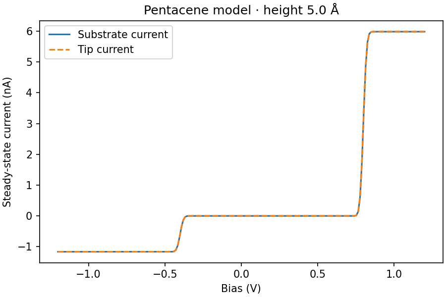
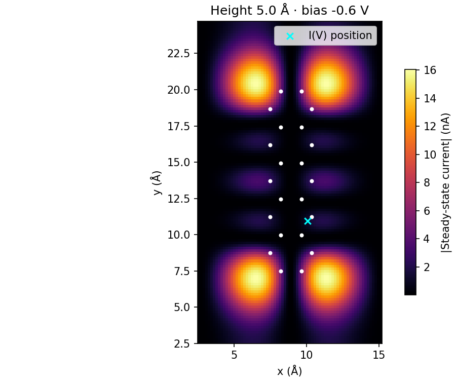

# Pentacene STM reference calculation

This example makes the existing pentacene notebook reproducible. It retains the
geometry, supplied HOMO/LUMO site vectors, three states, junction model, and
numerical settings of `pentacene_example.ipynb` at commit
`ebc6965e3e01fad739a0c95496c6a32165c7105e`. Existing meqpy authorship and licence
notices apply; see the repository README, CITATION.cff, and LICENSE.

## Initial baseline figures

These two PNGs show the initial reference calculation for review. They are
static baseline previews, not regenerated CI results. Download the workflow
artifact for the complete outputs of a particular commit.





The shared calculation is in `pentacene_calculation.py`. The notebook imports it;
the command-line run and notebook therefore use the same implementation. All
paths to the supplied inputs are relative to the script, not the working
directory. `example_parameters()` returns an editable copy of the complete model
settings.

## Run locally

From the repository root:

```sh
python -m pip install -e ".[examples]"
python docs/source/tutorials/dyson_from_2pz_vector/pentacene_calculation.py \
    --output-dir artifacts/pentacene
```

Open `pentacene_example.ipynb` and run all cells for an interactive view. To
execute it automatically, also from the repository root:

```sh
jupyter nbconvert --execute --to notebook \
    --ExecutePreprocessor.timeout=180 \
    docs/source/tutorials/dyson_from_2pz_vector/pentacene_example.ipynb \
    --output pentacene_example.executed.ipynb \
    --output-dir artifacts/pentacene
```

The `pentacene-example` CI job runs both commands. Download the
`pentacene-reference-<commit>` artifact from that workflow run to inspect the
figures, checks, data, and executed notebook. Apart from the two initial baseline
previews above, generated outputs are not committed.

## Model and conventions

- The states are GS (neutral singlet, 0 eV), D0- (anion doublet, 0.8 eV), and
  D0+ (cation doublet, 0.4 eV). No excited neutral states or relaxation channels
  are included.
- The supplied HOMO/LUMO coefficients and meqpy's model carbon 2pz functions
  represent the two charging transitions. These are not multireference Dyson
  orbitals.
- Gaussian broadening has a HWHM of 0.02 eV. This parameter is not a temperature.
- The vacuum decay mode is `10`, with zero padding. The sample distance is 3 Å;
  coupling uses the existing `Molecule.charging_rates` model.
- Coordinates retain the supplied XYZ frame. The source slice is at absolute
  z = 9 Å. The tip surface is at z = 12.5 Å, 5 Å above the carbon plane; its
  radius is 3 Å, so meqpy evaluates the orbital at z = 15.5 Å. These are distinct
  height definitions.
- The I(V) curve uses 200 biases from -1.2 to +1.2 V and the nearest grid point
  to (10, 11) Å. Both its requested and sampled coordinates are saved. The map
  uses a bias of -0.6 V. A separate zero-bias calculation checks zero current.
- Populations refer to spin multiplets; rates already include the library's
  Clebsch-Gordan factors. Both reported lead currents use the same
  tip-to-substrate sign convention.
- The original notebook's rounded elementary charge, 1.6022e-19 C, is retained
  to preserve the baseline. Numerical currents are saved in amperes; figures
  display nanoamperes. Signed map data are retained even though the figure
  displays their magnitude.

This is a model-orbital regression and internal-consistency example. It does not
establish grid convergence, the accuracy of absolute current, or agreement with
an experiment. The older handwritten notebook under `reference/` uses different
orbital and coupling approximations; its current is not an equivalent numerical
reference for this example.

## Outputs and checks

- `results.npz`: I(V), map coordinates and signed currents, both electrode
  currents, populations, charge differences, and the rates used to obtain them.
  Map arrays have x first and y second; the last population axis follows the
  ordered state list in `parameters.json`.
- `parameters.json`: model parameters, units, conventions, input-file SHA-256
  digests, and numerical-library versions.
- `checks.json`: finite-value checks, population normalization and positivity,
  the scaled stationary-equation residual, equality of lead currents, and
  zero-bias current. Tolerances are recorded explicitly. The command exits with
  a nonzero status if these checks fail.
- `iv`, `current_map`, and `populations`, each in PNG and PDF format, plus the
  executed notebook when the second command is run.

The tests also compare populations against the independent analytic solution
for this three-state network: for each charged state j,
`P_j / P_GS = Gamma_(GS->j) / Gamma_(j->GS)`. A small snapshot in
`tests/data/pentacene_reference.json` records values from the original notebook
for regression checking with stated tolerances. It is not an independent
physical reference. Later PRs should explain any intentional changes to these
values and rerun the same example.
